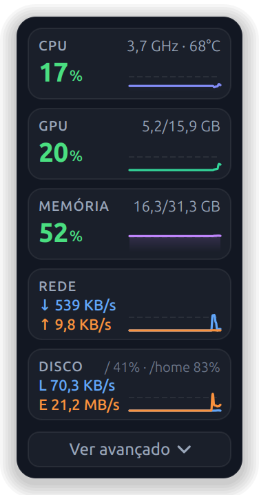
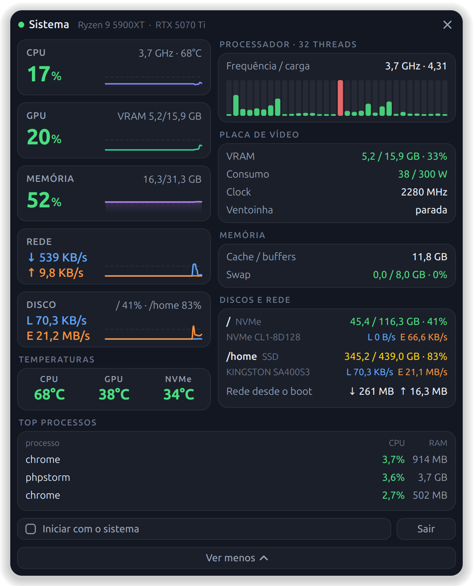

<div align="center">

# 📊 Monitor do Sistema

**Um card flutuante, sempre visível, que mostra como está o seu computador em tempo real.**
CPU, placa de vídeo, memória, rede, disco e temperaturas, no **Linux** e no **Windows**.

[](https://github.com/alanazeredoguedes/system-monitor/actions/workflows/build.yml)
[](https://github.com/alanazeredoguedes/system-monitor/releases/latest)


<table>
  <tr>
    <td align="center" valign="top"><b>Modo curto</b><br><br></td>
    <td align="center" valign="top"><b>Modo avançado</b><br><br></td>
  </tr>
</table>

</div>

---

## ✨ Funcionalidades

- **Sempre à vista:** o card fica sobreposto às outras janelas, sem borda, fora da barra de tarefas e **sem roubar o foco** do que você está fazendo.
- **Dois modos**, alternados pelo botão **Ver avançado / Ver menos**:
  - **Curto:** CPU, GPU, memória, rede e disco, cada um com o valor atual e um gráfico dos últimos 60 segundos.
  - **Avançado:** tudo do curto, mais temperaturas, uso de cada thread do processador, detalhes da placa de vídeo (VRAM, consumo, clock, ventoinha), cache e swap, uso de cada disco e os **3 processos** que mais consomem.
- **Atalho global** para mostrar e esconder o card de qualquer lugar.
- **Iniciar com o sistema:** uma caixinha no modo avançado liga ou desliga a abertura automática no login.
- **Ícone na bandeja** com o mesmo menu (mostrar/ocultar, avançado, iniciar com o sistema, sair).
- **Fácil de mover:** arraste com o mouse. O card lembra onde você deixou, em todas as áreas de trabalho.
- **Cores que avisam:** verde, amarelo e vermelho conforme a carga ou a temperatura.
- **Leve:** coleta a cada 1 segundo e só lê a lista de processos quando o modo avançado está aberto.

## ⬇️ Download

Baixe o executável pronto na [**página de Releases**](https://github.com/alanazeredoguedes/system-monitor/releases/latest):

| Sistema | Arquivo | Como usar |
|---|---|---|
| 🪟 **Windows** | [`sysmon.exe`](https://github.com/alanazeredoguedes/system-monitor/releases/latest/download/sysmon.exe) | Dê dois cliques. É um arquivo único, sem instalação. |
| 🐧 **Linux**, AppImage (arquivo único) | [`sysmon-x86_64.AppImage`](https://github.com/alanazeredoguedes/system-monitor/releases/latest/download/sysmon-x86_64.AppImage) | Dê permissão de execução e abra (veja abaixo). |
| 🐧 **Linux**, pasta (`.tar.gz`) | [`sysmon-linux-x86_64.tar.gz`](https://github.com/alanazeredoguedes/system-monitor/releases/latest/download/sysmon-linux-x86_64.tar.gz) | Extraia e execute `./sysmon/sysmon` (veja abaixo). |

### Linux

Os dois formatos precisam do `libxcb-cursor0` (usado pelo Qt), que no Ubuntu costuma já estar instalado:

```bash
sudo apt install libxcb-cursor0
```

**AppImage** (um arquivo só, não precisa extrair):

```bash
chmod +x sysmon-x86_64.AppImage
./sysmon-x86_64.AppImage
```

O AppImage precisa do FUSE para se montar. No Ubuntu 24.04 e no 22.04 o `fusermount` já vem instalado.
Se o seu sistema reclamar de `libfuse.so.2` (comum no Ubuntu 22.04 mais enxuto), instale com
`sudo apt install libfuse2` (no 24.04: `libfuse2t64`), ou rode sem FUSE com
`./sysmon-x86_64.AppImage --appimage-extract-and-run`.
Deixe o arquivo sempre no mesmo lugar: o início automático grava o caminho dele.

**Pasta `.tar.gz`** (abre mais rápido, bom para o atalho global):

```bash
tar -xzf sysmon-linux-x86_64.tar.gz
./sysmon/sysmon
```

Para ter o **atalho global**, abra *Configurações → Teclado → Atalhos personalizados* e crie um atalho
(por exemplo `Ctrl+Page Up`) com o comando `/caminho/para/sysmon/sysmon --toggle` (ou o caminho do AppImage).
Para **abrir com o sistema**, marque a caixinha no modo avançado.

> Se preferir, clone o repositório e rode `./install-linux.sh`, que configura o atalho, o início
> automático e a entrada no menu de aplicativos de uma vez (veja [Rodar a partir do código](#-rodar-a-partir-do-código)).

No Wayland o card roda via XWayland, que é o que permite ficar no topo e se posicionar. Para forçar o
Wayland nativo: `SYSMON_NATIVE=1`.

### Windows

1. Baixe o `sysmon.exe` e abra.
2. Na primeira vez o Windows pode mostrar o aviso *"O Windows protegeu o computador"*, porque o arquivo
   não é assinado digitalmente. Clique em **Mais informações → Executar assim mesmo**.
3. Para abrir junto com o Windows, marque **Iniciar com o sistema** no modo avançado (ou no menu da bandeja).

## ⌨️ Como usar

| Ação | Como |
|---|---|
| Mostrar / esconder o card | **Ctrl + Page Up** (padrão no Windows; no Linux é o atalho que você criar) |
| Mover | Arraste o card com o botão esquerdo |
| Alternar curto / avançado | Botão **Ver avançado** / **Ver menos** no rodapé do card |
| Iniciar com o sistema | Caixinha no modo avançado, ou menu da bandeja |
| Fechar o app | Botão **Sair** no modo avançado, ou menu da bandeja |

> No Windows, enquanto o app estiver aberto, o **Ctrl + Page Up** tem prioridade sobre o "trocar de aba"
> do navegador e do editor. Se isso atrapalhar, escolha outro atalho (veja abaixo).

### Linha de comando

```text
sysmon                    abre, ou alterna o card se o app já estiver rodando
sysmon --toggle           mostra / esconde
sysmon --show | --hide    mostra / esconde explicitamente
sysmon --advanced         alterna o modo avançado
sysmon --hidden           inicia sem mostrar o card
sysmon --quit             encerra o monitor
sysmon --autostart on|off liga / desliga o início automático
sysmon --hotkey ctrl+alt+m   (Windows) usa outro atalho global
```

### Configuração

O app guarda posição, modo e atalho em um arquivo simples:

- **Linux:** `~/.config/sysmon/config.json`
- **Windows:** `%APPDATA%\sysmon\config.json`

Para mudar o atalho do Windows de forma fixa, adicione `"hotkey": "ctrl+alt+m"` a esse arquivo. Formato:
modificadores (`ctrl`, `alt`, `shift`, `win`) + uma tecla (letra, número, `F1`…`F24`, `pageup`, `home`…).
Se algo der errado com o atalho, o log fica em `sysmon.log` na mesma pasta.

## 🛠️ Rodar a partir do código

Testado com Python 3.12.

```bash
git clone https://github.com/alanazeredoguedes/system-monitor.git
cd system-monitor

python3 -m venv .venv
.venv/bin/pip install -r requirements.txt        # Windows: .venv\Scripts\pip ...
.venv/bin/python sysmon.py                       # Windows: .venv\Scripts\python sysmon.py
```

No Linux (GNOME), para instalar atalho, início automático e entrada no menu:

```bash
./install-linux.sh                               # atalho padrão: Ctrl+Page Up
SHORTCUT='<Super>m' ./install-linux.sh           # outro atalho
./install-linux.sh --uninstall
```

## 📦 Gerar o executável

O executável é gerado com o [PyInstaller](https://pyinstaller.org). Ele **não compila para outro sistema**:
o Linux é compilado no Linux e o Windows no Windows.

```bash
# Linux  ->  dist/sysmon/sysmon  e  dist/sysmon-linux-x86_64.tar.gz
./build.sh

# Linux, AppImage  ->  dist/sysmon-x86_64.AppImage  (rode o build.sh antes)
./build-appimage.sh

# Windows (PowerShell)  ->  dist\sysmon.exe
.\build.ps1
```

### Release automática (GitHub Actions)

O workflow [`build.yml`](.github/workflows/build.yml) faz tudo na nuvem, sem precisar de uma máquina Windows:

- **A cada commit na `main`:** roda os testes e compila Linux e Windows, só para conferir.
- **A cada tag `vX.Y.Z`:** compila os dois e publica uma **Release** com `sysmon.exe`, `sysmon-linux-x86_64.tar.gz` e `sysmon-x86_64.AppImage`.

O script `release.sh` faz isso por você: roda os testes, cria a tag e envia, pedindo confirmação a cada passo.

```bash
./release.sh 1.2.0
```

## ⚠️ Limitações conhecidas

- **GPU:** só placas **NVIDIA** (via NVML). Sem NVIDIA, o card mostra "NVIDIA não detectada".
- **Windows:**
  - não mostra a temperatura da CPU nem dos discos (o sistema não expõe isso sem drivers de terceiros);
  - a leitura e a escrita de disco aparecem como o total da máquina, não por partição;
  - o atalho global, a bandeja e o início automático ainda estão em validação.
- **Linux:** testado no Ubuntu com GNOME. O ícone na bandeja usa a extensão de indicadores que já vem ativa no Ubuntu.

## 🧱 Estrutura do projeto

```text
sysmon.py            ponto de entrada
sysmon/
  cli.py             linha de comando e controle da instância em execução
  app.py             janela, coleta a cada 1 s, bandeja e atalho global
  ui.py              o card (desenho com QPainter)
  metrics.py         CPU, GPU, memória, rede, disco, temperaturas e processos
  winhotkey.py       atalho global do Windows
  autostart.py       iniciar com o sistema (Linux e Windows)
  ipc.py, paths.py, log.py
packaging/           ícone e entrada de menu usados no AppImage
tests/               testes automatizados
legado/              versão original em GTK (somente Linux), mantida como referência
docs/                imagens deste README
```

Para rodar os testes:

```bash
.venv/bin/pip install -r requirements-dev.txt
QT_QPA_PLATFORM=offscreen .venv/bin/python -m pytest -q
```
